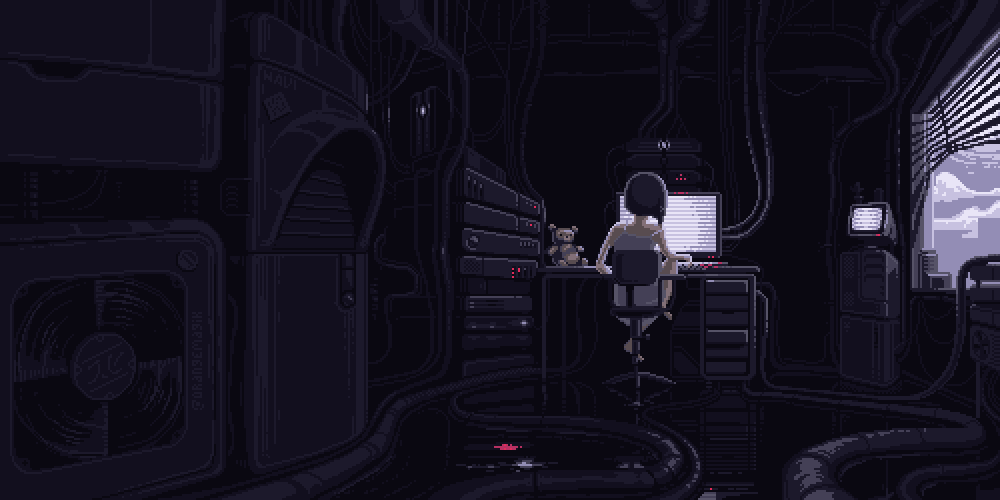
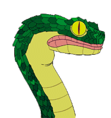

  <!-- Encabezado -->
  

    
  

  <!-- Insignias -->
  

    
    
    
    
  

  <!-- Presentación -->
# ¡Hola 👋! Soy Ghozd

 **Defensor de la privacidad.**

  <!-- Imágenes de perfil --> 
<table align="center" style="border-collapse: collapse; border: none;">
  <tr>
    <td align="center" style="padding: 0; border: none;">
      
    </td>
    <td align="center" style="padding: 0; border: none;">
      
    </td>
  </tr>
</table> 

 ---

  <!-- Lenguajes -->
  
<b>Lenguajes</b>

  

    
  

  <!-- Herramientas -->
  
<b>Herramientas</b>

  

    
  

  <!-- Estadísticas de GitHub -->
  

    <b>Mis estadísticas de GitHub</b>
  

  

    <a href="https://github.com/jeantimex/neofetch-profile">
      <picture>
        <source media="(prefers-color-scheme: dark)" srcset="https://neofetch-profile.vercel.app/api?username=gh0zd&theme=github-dark&config=https%3A%2F%2Fraw.githubusercontent.com%2Fgh0zd%2Fgh0zd%2Fmain%2Fneofetch.json&v=10">
        
      </picture>
    </a>
  

  

    
  

  

    
  

  

    
  

  ---

  <!-- Animación de contribuciones -->
### 🚀 ¿De quién es esta serpiente? 

  <!--Footer-->
  

    
  

